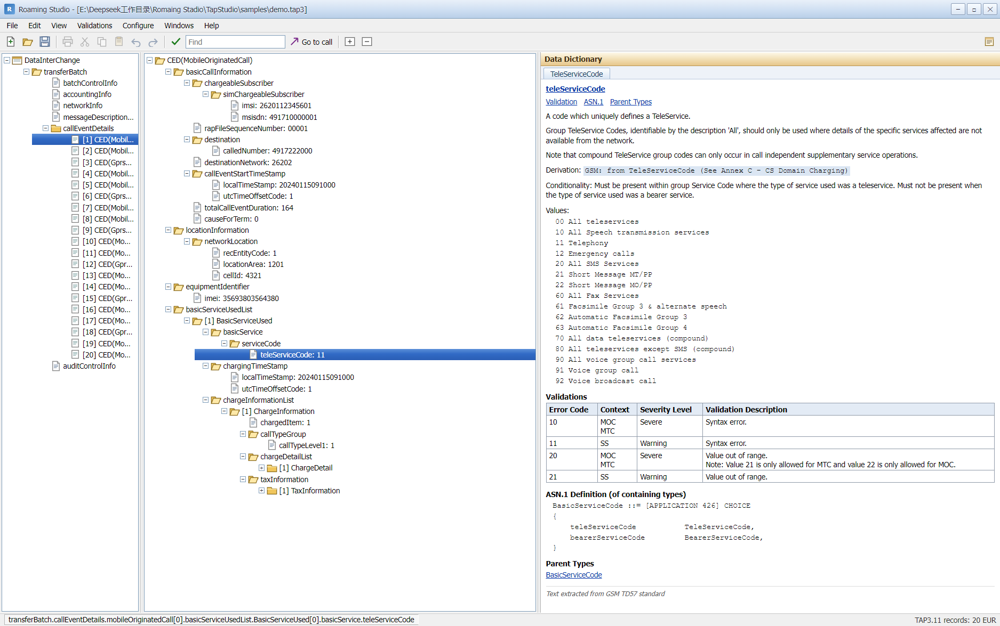
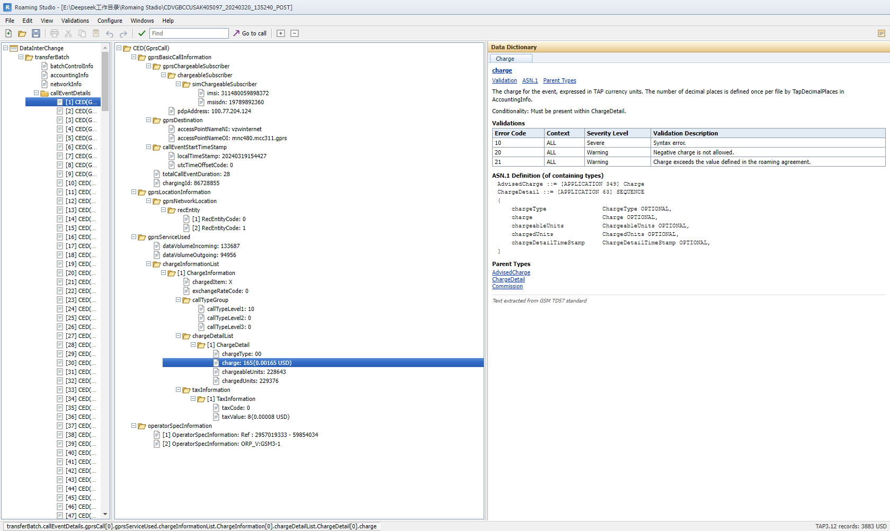
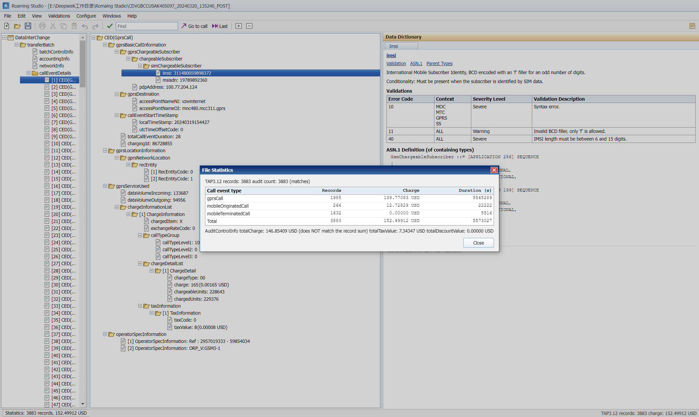
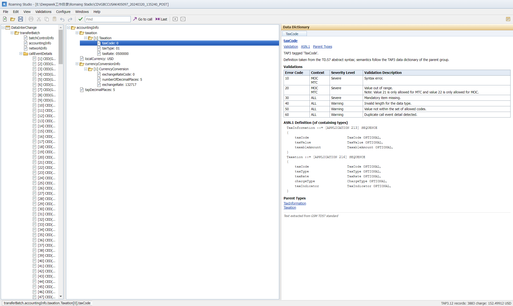
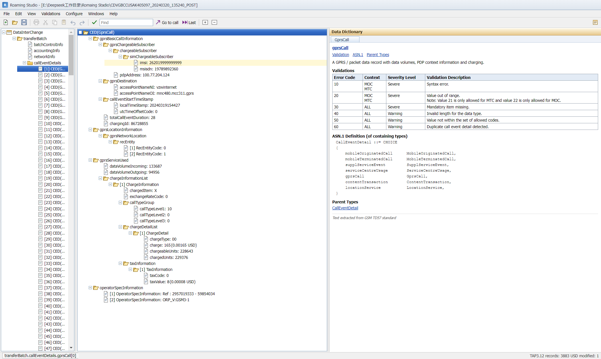
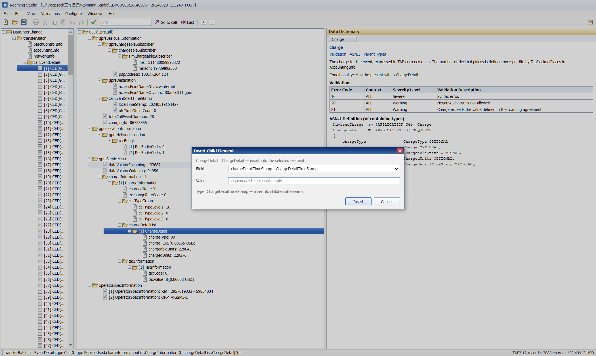
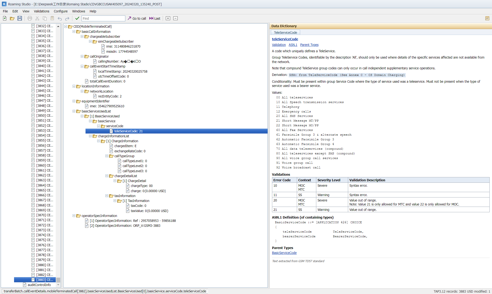

# Roaming Studio · TAP3 Studio

> 开源、跨平台的 **TAP3 / RAP / NRTRDE** 查看器、编辑器、校验器与统计工具。
> Schema-driven TAP3 tooling with a TD.57 data dictionary, byte-preserving edits and a classic desktop UI.

[](LICENSE)
[](requirements.txt)
[](desktop/)
[](desktop/)
[](https://github.com/zhutou0622/roaming-studio/actions/workflows/ci.yml)




---

## English overview

Roaming Studio is an independent, open-source reimplementation of the day-to-day workflow of a
legacy TAP3 desktop editor: browse the ASN.1 tree of a transfer batch, inspect TD.57 field
semantics, edit values in place, reconcile charges against `AuditControlInfo`, and export the
result. It ships as an Electron desktop app with a bundled Python backend (no Python required on
the target machine), a local REST API and a CLI.

**Highlights**

- Schema-driven BER/ASN.1 decoding for TAP3.09 / TAP3.11 modules (release 1–12 files recognised).
- Byte-preserving saves: untouched files re-encode to the exact original bytes, including
  indefinite-length (`0x80 … 00 00`) elements.
- TD.57 **Data Dictionary** pane: description, derivation, conditionality, code lists, validation
  tables, ASN.1 definition and parent types, generated from the parsed schema.
- 30+ validation rules (structure, accounting, audit reconciliation, timestamps, BCD, duplicates).
- Interactive tree editing with “modified” highlighting that keeps the current call record in view.
- Handles large files: 168k nodes / 3,883 call records open in ~1.2 s, navigation in milliseconds.
- CSV / JSON / Tap3Info XML / listing / statistics export, merge and split, CLI and REST API.

---

## 功能特性

| 领域 | 能力 |
| --- | --- |
| 解析 | 随包 15 个 ASN.1 模块：TAP3.01–3.12、RAP1.01–1.05、NRTRDE 2.1；按 release 自动选模块；BER 定长/不定长、CHOICE 线上形态、BCD/数字串/HexString/INTEGER 值语义 |
| 浏览 | `DataInterChange → transferBatch → batchControlInfo / accountingInfo / networkInfo / messageDescriptionInfo / callEventDetails / auditControlInfo` 导航；ASN.1 树按需展开；选中分组自动全展开 |
| 数据字典 | 描述 / Derivation / Conditionality / Values 码表 / Validations 表 / ASN.1 Definition / Parent Types，随节点切换；TAP / RAP / NRTRDE 类型均可查询 |
| 编辑 | 值编辑、HEX 写入、克隆、删除；**schema 驱动插入子/兄弟节点**（按 SEQUENCE 字段顺序落位、拒绝重复字段）；修改字段浅黄高亮；保持当前话单视图；`Ctrl+S` 原地覆盖、不改文件名 |
| 校验 | 结构、账务、网络、事件、时间戳、审计勾稽、BCD 语法、重复记录；报告可点击定位；**规则配置化**（逐条 severity/off、时长阈值、金额容差、重复检测开关） |
| 统计 | 按事件类型统计条数/金额/时长，并与 `AuditControlInfo.totalCharge` 勾稽 |
| 文件操作 | 合并（拒绝跨 release）、按记录拆分、CSV/JSON/XML/Listing/统计报表导出；**Listing 导入**（自有格式）；**批量目录巡检**（CLI + UI，CSV / Excel 汇总）；**校验失败生成 RAP1.05 返回文件**（SevereReturn / FatalReturn） |
| 导航 | `Ctrl+Home` / `Ctrl+End` 直达首/末话单；`Go to Call…` 按序号跳转 |
| 性能 | 168,605 节点 / 3,883 记录：打开 1.2 s、切换话单 8 ms、校验 0.27 s |
| 交付形态 | Electron 桌面版（Windows，内置后端，无需 Python）、浏览器模式、CLI |

## 截图

| 大文件浏览（168k 节点） | 文件统计与审计勾稽 |
| --- | --- |
|  |  |

| 分组全展开 | 编辑标记与末条跳转 |
| --- | --- |
|  |  |

| 插入子/兄弟节点向导 | 直达最后一条话单 |
| --- | --- |
|  |  |

---

## 快速开始

### 1. 桌面版（推荐，Windows 10/11，目标机器无需 Python）

从 [Releases](https://github.com/zhutou0622/roaming-studio/releases) 下载安装版或便携版：

- `Roaming-Studio-<version>-portable.exe`：便携版，双击即用；
- `Roaming-Studio-Setup-<version>.exe`：安装版（开始菜单 / 桌面快捷方式）。

本地构建：

```bat
pip install -r requirements.txt
pyinstaller --noconfirm --onedir --name tap3-server --distpath dist/onedir ^
  --add-data "tap3studio/schema;tap3studio/schema" --add-data "web;web" ^
  --hidden-import uvicorn.logging --hidden-import uvicorn.loops.auto ^
  --hidden-import uvicorn.protocols.http.auto --hidden-import uvicorn.protocols.websockets.auto ^
  --hidden-import uvicorn.lifespan.on ^
  --exclude-module numpy --exclude-module pandas --exclude-module PIL --exclude-module jedi ^
  --exclude-module matplotlib --exclude-module tkinter --exclude-module IPython ^
  --exclude-module Pythonwin --exclude-module win32com ^
  server_entry.py

cd desktop
npm install
npm run dist        :: release\Roaming-Studio-Setup-*.exe + portable
```

> 首次手动启动开发版：`env -u ELECTRON_RUN_AS_NODE npm start`（某些 IDE 会设置该变量）。

### 2. 浏览器 / 开发模式

```bat
pip install -r requirements.txt
python run.py                                 :: http://127.0.0.1:8765
python run.py --open samples\demo.tap3        :: 启动即加载文件
```

### 3. CLI

```bat
python -m tap3studio.cli generate samples\demo.tap3 --events 500
python -m tap3studio.cli info samples\demo.tap3
python -m tap3studio.cli validate samples\demo.tap3 --json
python -m tap3studio.cli events samples\demo.tap3 --limit 20
python -m tap3studio.cli search samples\demo.tap3 26201
python -m tap3studio.cli dump samples\demo.tap3 --limit 80
python -m tap3studio.cli merge a.tap3 b.tap3 --out merged.tap3
python -m tap3studio.cli split samples\demo.tap3 --prefix part_ --chunk 100
python -m tap3studio.cli export samples\demo.tap3 --fmt csv --out records.csv
python -m tap3studio.cli batch "D:	ap_in" --pattern "*.tap3" --csv scan.csv --xlsx scan.xlsx
python -m tap3studio.cli rap samples\demo.tap3 --out return_RAP.rap --errors-only
python -m tap3studio.cli import-listing records.lis --out imported.tap3
python -m tap3studio.cli validate file.tap3 --profile profiles/operator-a.json
```

`samples/demo.tap3` 由内置生成器产生（MO / MT / GPRS 混合，带完整审计组），可直接用于试用与测试。

---

## 支持的格式

| 文件 | 状态 |
| --- | --- |
| TAP3（release 1–4、9–12） | ✅ 结构化浏览/编辑/校验；TAP3.01–3.12 模块随包，按 release 自动选择 |
| RAP1（release 1–5） | ✅ 专用 schema：结构化浏览/编辑/字典；校验规则暂只针对 TAP3（批量巡检中标记 SKIPPED） |
| NRTRDE 2.1 | ✅ 专用 schema：结构化浏览/编辑/字典；同样暂不做字段级校验 |
| Listing（自有格式） | ✅ 导出；导入按记录属性重建骨架 |
| Tap3Info XML / CSV / JSON | ✅ 导出 |

> 任意 BER 文件都能以通用 TLV 树打开；schema 未覆盖的字段会带标注告警，而不是解码失败。

---

## 架构

```
TapStudio/
├─ run.py                    # uvicorn 启动器（可选预打开文件）
├─ server_entry.py           # PyInstaller 入口
├─ tap3studio/
│  ├─ asn1model.py           # TD.57 ASN.1 解析器 → 类型模型
│  ├─ ber.py                 # BER 编解码（保留 tag / 偏移 / 不定长）
│  ├─ tapfile.py             # Tap3Document：标注、事件、编辑、导出、修改标记
│  ├─ builder.py             # schema + dict → 合法 TAP3 子树
│  ├─ generator.py           # 合成 TAP3.11 测试文件
│  ├─ dictionary.py          # TD.57 词条 / 码表 / 校验表 / ASN.1 渲染
│  ├─ validate.py            # 校验规则引擎
│  ├─ ops.py                 # 合并 / 拆分 / Listing 导入
│  ├─ server.py              # FastAPI REST + 静态前端
│  └─ schema/                # TAP0301–0312、RAP0101–0105、NRT0201（15 个 ASN.1 模块）
├─ web/                      # 经典 Win32 风格前端（无构建步骤）
├─ desktop/                  # Electron 外壳（main / backend / preload / tests）
├─ tests/                    # 29 个单元与性能回归测试
└─ docs/                     # 截图、性能与修复记录
```

### 关键设计

1. **Schema 驱动**：解析 TD.57 的 ASN.1 文本得到 tag → 字段名/类型映射；先用原始 TLV 嗅探 `releaseVersionNumber` 选模块，只在 mismatch 偏高时才回退另一模块。
2. **字节级保真**：节点保留 tag class/num、偏移、原始 payload 与 `indefinite` 标记；改值只替换目标 payload，未改动文件 `to_bytes() == 原始字节`（含不定长元素）。
3. **CHOICE 线上形态**：`[APPLICATION 427] CHOICE` 等类型在报文中直接以被选分支 tag 出现，解码器同时接受外层 tag 与分支 tag；UI 还原“字段组 + 选中分支”两级。
4. **大文件优先**：header 走名字索引 + 缓存；节点检查器只回浅层数据；`/api/tree` 按节点类型限深并设 20k 节点预算；左树分块 + 滚动续载。
5. **无状态前端 + REST**：编辑、校验、合并、导出全部可脚本调用，便于接入批处理。

---

## 性能（实测）

样本：1.08 MB TAP3.12，**168,605 个 ASN.1 节点 / 3,883 条话单**。

| 操作 | 优化前 | 优化后 |
| --- | --- | --- |
| 打开文件 | 2.0 s | **1.2 s** |
| header 计算（state/nav/save） | 4.3 s / 次 | **< 1 ms** |
| 打开 `callEventDetails` | 65.6 MB JSON，界面卡死 | **0.34 s / 3,884 行** |
| 节点检查器（根节点） | 70.7 MB JSON | **0.7 KB** |
| 左树 3,883 行 | 一次性建 DOM | **400 行/块 + 滚动续载** |
| 未修改另存 | 多 1 字节 | **字节级一致** |

完整根因、复测脚本与交互修复记录见 [docs/performance.md](docs/performance.md)。

---

## 校验规则

| 组 | 代码 | 示例 |
| --- | --- | --- |
| 结构 | `TAP-001..008` | batchControlInfo 缺失、必填项缺失（`fileTypeIndicator` 按 TD.57 为可选）、fileSequenceNumber 非 5 位、release 越界、schema 未映射元素 |
| 账务 | `ACC-001..003` | accountingInfo / localCurrency / tapDecimalPlaces 缺失、dp 越界 |
| 网络 | `NET-001..003` | utcTimeOffsetInfo 缺失、偏移格式错误、引用未声明的 utcTimeOffsetCode |
| 事件 | `EVT-001..009` | 事件为空、未知类型、MO/MT/GPRS 必填组缺失、时长异常、负金额、无计费信息、疑似重复 |
| 时间 | `TS-001..003` | 本地时间戳非 `CCYYMMDDhhmmss`、UTC 偏移非 `±hhmm` |
| 审计 | `AUD-001..005` | auditControlInfo 缺失、`callEventDetailsCount` 与记录数不符、`totalCharge` 与明细合计不符、earliest > latest |
| 语法 | `BCD-001` | IMSI / MSISDN / IMEI 非 BCD 数字 |

CLI `validate` 有 error 时退出码为 1，可直接接入流水线。

---

## REST API（节选）

| 方法 | 路径 | 作用 |
| --- | --- | --- |
| GET | `/api/state` | 当前文件摘要 + 根节点 |
| POST | `/api/open` | `{path}` 打开；留空生成测试文件 |
| POST | `/api/tree` | `{id,depth}` 懒加载子树（20k 节点预算） |
| GET | `/api/node/{id}` | 节点详情（浅层 + 祖先链 + 原始字节） |
| POST | `/api/value` / `/api/delete` / `/api/clone` | 编辑操作 |
| GET | `/api/insert/options?id=` | 当前节点可插入的 schema 字段/分支 |
| POST | `/api/insert` | 按 schema 插入子/兄弟节点 |
| POST | `/api/save` | 按给定路径原地覆盖（不改名、不补扩展名） |
| GET/POST | `/api/validate` | 全量校验（POST 可带 `profile`） |
| GET | `/api/rules` | 规则目录、默认严重级别与阈值 |
| POST | `/api/import-listing` | 从 Listing 文本重建 TAP3 骨架 |
| POST | `/api/batch` / `/api/batch/export` | 批量巡检 / 导出 CSV 或 Excel |
| POST | `/api/rap` | 由校验结果生成 RAP1.05 返回文件 |
| GET | `/api/statistics` | 按类型统计 + 审计勾稽 |
| GET | `/api/dictionary?type=&field=` | TD.57 词条 |
| GET | `/api/events` / `/api/hex` / `/api/search` | 记录表 / 字节 / 搜索 |
| POST | `/api/replace` / `/api/merge` / `/api/split` | 批量替换 / 合并 / 拆分 |
| GET | `/api/export?fmt=csv\|json\|xml\|listing\|stat` | 导出 |

完整的 20+ 端点与请求体见 `tap3studio/server.py`。

---

## 测试

```bat
python -m unittest discover -s tests -v          :: 57 项（含大文件性能/保存命名/插入/规则配置/批量巡检/多 schema/RAP/Listing）
python -m tap3studio.cli validate samples\demo.tap3

cd desktop
npx electron uitest.js                            :: 14 项基础 UI 回归
npx electron uitest-large.js "<大 TAP 文件>"      :: 24 项（右键/Find/编辑/统计/末条跳转/保存命名）
npx electron uitest-sections.js "<大 TAP 文件>"   :: 10 项（分组全展开）
npx electron perf.js "<大 TAP 文件>"              :: 性能探针
```

CI（[.github/workflows/ci.yml](.github/workflows/ci.yml)）在 push / PR 时运行 Python 单测与前端语法检查。

---

## 路线图

- [x] 插入子/兄弟节点向导（`/api/insert/options` + `/api/insert`，按 SEQUENCE 顺序落位并拒绝重复字段）
- [x] TAP3.01–3.12 / RAP1.01–1.05 / NRTRDE 2.1 专用 schema（按 release 自动选模块、字典可查）
- [x] 校验失败自动生成 RAP 返回文件（RapBatchControlInfo / SevereReturn / FatalReturn / RapAuditControlInfo）
- [x] 校验规则配置化（JSON 规则集、severity/off、阈值、error override 语义）
- [x] 批量目录巡检 + 汇总报表（CLI + UI，CSV / Excel）
- [x] Listing 导出 / 导入闭环（Roaming Studio 自有 listing 格式）
- [ ] **原生** TAP3 Listing 列位解析（需要真实运营商 `.lis` 样本；自有格式已可导入）
- [x] Electron 桌面封装 + PyInstaller 冻结后端
- [x] 大文件性能优化与交互回归测试

---

## 背景与声明

本项目是独立实现，与 **Semantix**、**XINTEC**、**INFOBRAIN AG** 及任何 TAP3 商业编辑器厂商
无隶属或授权关系。项目中的界面布局参考了漫游结算行业常见的桌面工具形态，代码、schema 解析器、
校验规则与前端均为自行实现；未复制、反编译或再分发任何第三方程序的代码或资源。

TAP3 / TD.57 / TADIG 是 **GSMA** 的规范与商标；本仓库内置的 ASN.1 模块与词条文本来自公开规范，
仅用于互操作性实现。请以 GSMA 官方发布版本为准。

⚠️ 当前为 **beta**：请在测试环境验证后再用于生产结算流程。仓库不包含任何运营商客户数据，
`samples/` 中的文件由内置生成器合成。

## 贡献

欢迎 issue / PR：开发环境、测试要求与代码风格见 [CONTRIBUTING.md](CONTRIBUTING.md)。

## 许可证

[MIT](LICENSE) © 2026 Roaming Studio contributors
