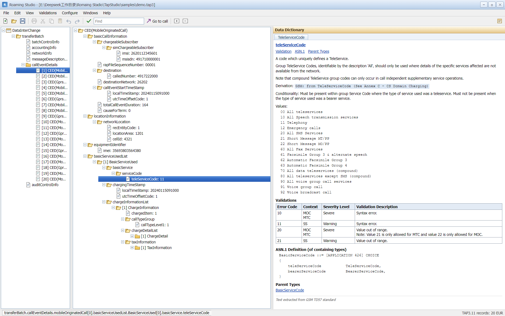

# Roaming Studio · Desktop (Electron)

**English** | [简体中文](README.zh-CN.md)

The Electron shell hosts the Python backend and provides a double-click desktop tool. The UI
follows the classic Win32 layout used by roaming settlement tools: custom title bar, menu bar,
three panes (navigation tree / ASN.1 tree / Data Dictionary) and a status bar; editing and
validation happen in classic dialogs.



Native features: frameless window with custom minimize/maximize/close, native Open / Save As
dialogs, drag-and-drop, single instance, backend log, and backend shutdown on exit.

## Layout

```
desktop/
├─ package.json       Electron + electron-builder config (nsis + portable)
├─ main.js            main process: backend lifecycle, window, menu, IPC, single instance
├─ backend.js         backend lifecycle: exe/python lookup, free port, health check, graceful stop
├─ preload.js         contextBridge: window.tap3desktop
├─ selftest.js        headless backend self-test (node selftest.js)
└─ assets/            icon.png / icon.ico
```

## Backend resolution order (`backend.js`)

1. `TAP3SERVER_EXE` environment variable
2. Packaged: `resources/backend/onedir/tap3-server.exe` (PyInstaller onedir, ~0.9 s start)
3. Packaged (legacy layout): `resources/backend/tap3-server.exe` (onefile)
4. Development: `<repo>/dist/onedir/tap3-server/tap3-server.exe` → `<repo>/dist/tap3-server.exe`
5. Fallback: `TAP3STUDIO_PYTHON` → `<repo>/.venv/Scripts/python.exe` → `python -m tap3studio.server`

The backend listens on `127.0.0.1:<random free port>`; the main process polls `/api/state` until it
is ready (45 s timeout) and shows an error dialog with the log path on failure.

## Development

```bat
cd desktop
npm install
npm run start            :: start the desktop app
npm run selftest         :: backend pipeline only, no window
```

Rebuild the bundled backend (repo root; onedir is the default packaging form, 27 MB, ~1.2 s cold start):

```bat
python -m PyInstaller --noconfirm --onedir --name tap3-server --distpath dist/onedir ^
  --add-data "tap3studio/schema;tap3studio/schema" ^
  --add-data "web;web" ^
  --hidden-import uvicorn.logging ^
  --hidden-import uvicorn.loops.auto ^
  --hidden-import uvicorn.protocols.http.auto ^
  --hidden-import uvicorn.protocols.websockets.auto ^
  --hidden-import uvicorn.lifespan.on ^
  --exclude-module numpy --exclude-module pandas --exclude-module PIL --exclude-module jedi ^
  --exclude-module matplotlib --exclude-module tkinter --exclude-module IPython ^
  --exclude-module Pythonwin --exclude-module win32com ^
  server_entry.py
```

A onefile build is still possible (`--onefile`), but it unpacks ~38 MB per launch and starts in ~19 s.

## Packaging

```bat
npm run pack    :: unpacked directory in release/win-unpacked
npm run dist    :: NSIS installer + portable exe (release/)
```

Artifacts: `release/Roaming-Studio-Setup-<version>.exe`, `release/Roaming-Studio-<version>-portable.exe`,
`release/win-unpacked/`.

Packaging copies `main.js/preload.js/backend.js/assets` into the asar, and `dist/onedir/tap3-server`
plus `samples/` into `resources/backend` and `resources/samples`, so the target machine needs no
Python installation.

## Desktop behaviour

| Behaviour | Implementation |
| --- | --- |
| Native Open dialog (Ctrl+O) | menu → `dialog.showOpenDialog` → `POST /api/open` → page reload |
| Save As (Ctrl+S) | `dialog.showSaveDialog` → `POST /api/save` (same file name, overwrite in place) |
| Drag and drop | `webUtils.getPathForFile` → same `/api/open` flow |
| Open sample | `resources/samples/demo.tap3` (falls back to repo `samples/` in development) |
| Backend log | `%APPDATA%/TAP3 Studio/backend.log`, Help → Backend Log |
| Single instance | `requestSingleInstanceLock`; a second instance forwards the file argument |
| Exit cleanup | `before-quit` → `taskkill /pid <pid> /t /f` (SIGTERM elsewhere) |
| Smoke test | `TAP3_SMOKE=1 npx electron .` loads, reports the desktop API and exits |
| UI regression | `npx electron uitest.js` (14 checks) |
| Large-file UI regression | `npx electron uitest-large.js "<file>"` |
| Section expansion test | `npx electron uitest-sections.js "<file>"` |
| Screenshots | `npx electron shot.js [out.png] [w] [h] [file]` → `../docs/ui-dev.png` |
| Performance probe | `npx electron perf.js "<file>"` |

## Large-file performance

- 3,883 call records / 168,605 nodes: backend decode 1.2 s, first paint ~0.25 s,
  `callEventDetails` 0.34 s, single CED 8 ms.
- Key points: name-indexed and cached header, shallow node details, per-node depth limits plus a
  20k node budget in `/api/tree`, chunked navigation with incremental loading, and byte-identical
  saves that preserve BER indefinite lengths.
- Details: `../docs/performance.md` (Chinese); regression: `python -m unittest tests.test_performance`.

## Notes and limitations

- `Ctrl+S` keeps the original file name and overwrites in place (operator drop files without an
  extension are not renamed to `.tap3`).
- The status bar shows `records: N` and `charge: x.xxxxx USD` separately;
  `Validations → File Statistics...` shows per-type numbers and the `AuditControlInfo` reconciliation.
- After editing, the current call tree stays in view; modified fields are highlighted and the
  status bar shows `modified: N`. `View → Clear Modification Marks` clears them.
- `Ctrl+Home` / `Ctrl+End` (or the toolbar `Last`) jump to the first/last call; the navigation tree
  loads the remaining chunks automatically.
- `Configure → Validation Profile...` sets per-rule severity/off, duration threshold, charge
  tolerance and duplicate detection.
- `File → Import Listing...` rebuilds a TAP3 skeleton from a Roaming Studio listing;
  `File → Batch Scan Folder...` scans a folder, exports CSV/Excel and opens a row on double-click.
- `Validations → Generate RAP Return File...` writes a RAP1.05 return file from the findings.
- Selecting `accountingInfo`, `networkInfo`, `batchControlInfo` or `auditControlInfo` expands the
  whole section; `callEventDetails` and the document root stay shallow to avoid rendering tens of
  thousands of rows.
- The packaged backend is onedir (ready in ~0.85 s, smoke test 3.8 s); onefile is a fallback.
- The window is shown after `ready-to-show` to avoid a white flash.
- If the shell exports `ELECTRON_RUN_AS_NODE=1`, Electron runs as Node and fails with
  `app is undefined`: use `env -u ELECTRON_RUN_AS_NODE npm start`.
- Unsigned executables may trigger SmartScreen; sign before public distribution
  (`win.certificateFile` / `CSC_LINK`).
- The portable build extracts the backend to a temp directory on every launch; switch to onedir
  packaging for the fastest start.
