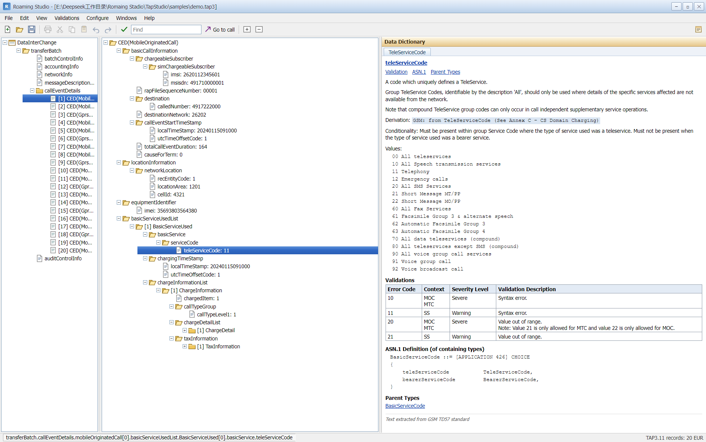

# TAP3 Studio · 桌面版（Electron）

[English](README.md) | **简体中文**

把 `TapStudio` 的 Python 后端装进 Electron 外壳，得到双击即用的桌面工具。界面采用漫游结算工具常见的经典 Win32 布局：自绘标题栏 + 菜单栏 + 三窗格（导航树 / ASN.1 树 / Data Dictionary）+ 状态栏，编辑与校验用经典对话框完成。



原生能力：无边框窗口（自绘最小化/最大化/关闭）、原生「打开文件 / 保存到…」对话框、拖拽打开、单实例、后台日志、退出时回收后端进程。

## 目录

```
desktop/
├─ package.json       Electron + electron-builder 配置（nsis + portable）
├─ main.js            主进程：启动后端、窗口、菜单、IPC、单实例
├─ backend.js         后端生命周期：找 exe / 找 python、空闲端口、健康检查、优雅退出
├─ preload.js         contextBridge：window.tap3desktop
├─ selftest.js        无窗口自检（node selftest.js）
└─ assets/            icon.png / icon.ico
```

## 后端解析顺序（`backend.js`）

1. `TAP3SERVER_EXE` 环境变量
2. 打包后：`resources/backend/onedir/tap3-server.exe`（PyInstaller onedir，启动约 0.9s）
3. 打包后（旧布局）：`resources/backend/tap3-server.exe`（onefile）
4. 开发态：`<repo>/dist/onedir/tap3-server/tap3-server.exe` → `<repo>/dist/tap3-server.exe`
5. 回退：`TAP3STUDIO_PYTHON` → `<repo>/.venv/Scripts/python.exe` → `python`，执行 `-m tap3studio.server`

后端固定监听 `127.0.0.1:<随机空闲端口>`，主进程轮询 `/api/state` 直到就绪（默认 45s 超时），失败弹窗给出路径与日志位置。

## 开发运行

```bat
cd desktop
npm install
npm run start            :: 启动桌面应用
npm run selftest         :: 只测后端管道，不开窗口
```

生成/更新内置后端（仓库根目录，onedir 为默认打包形态，27MB、1.2s 冷启动）：

```bat
python -m PyInstaller --noconfirm --onedir --name tap3-server --distpath dist/onedir ^
  --add-data "tap3studio/schema;tap3studio/schema" ^
  --add-data "web;web" ^
  --hidden-import uvicorn.logging ^
  --hidden-import uvicorn.loops.auto ^
  --hidden-import uvicorn.protocols.http.auto ^
  --hidden-import uvicorn.protocols.websockets.auto ^
  --hidden-import uvicorn.lifespan.on ^
  --exclude-module numpy --exclude-module pandas --exclude-module PIL --exclude-module jedi ^
  --exclude-module matplotlib --exclude-module tkinter --exclude-module IPython ^
  --exclude-module Pythonwin --exclude-module win32com ^
  server_entry.py
```

单文件（onefile）版本仍可作为备选：把 `--onedir` 换成 `--onefile`，输出 `dist/tap3-server.exe`，启动约 19s（每次解包 38MB）。

## 打包

```bat
npm run pack    :: 免安装目录 release/win-unpacked
npm run dist    :: NSIS 安装包 + 便携版 exe（release/）
```

产物：`release/Roaming-Studio-Setup-<version>.exe`（安装版）、`release/Roaming-Studio-<version>-portable.exe`（便携版）、`release/win-unpacked/`（免安装目录）。

打包内容：`main.js/preload.js/backend.js/assets` 进 asar；`dist/onedir/tap3-server` 与 `samples/` 作为 `extraResources` 落到 `resources/backend`、`resources/samples`，因此目标机器**不需要装 Python**。

## 桌面端专属行为

| 行为 | 实现 |
| --- | --- |
| 原生打开对话框（Ctrl+O） | 菜单 → `dialog.showOpenDialog` → `POST /api/open` → 重载页面 |
| 保存到…（Ctrl+S） | `dialog.showSaveDialog` → `POST /api/save`（沿用原名、原地覆盖） |
| 拖拽文件打开 | `webUtils.getPathForFile` → 同一个 `/api/open` 流程 |
| 打开示例文件 | `resources/samples/demo.tap3`（开发态回退仓库 `samples/`） |
| 后台日志 | `%APPDATA%/TAP3 Studio/backend.log`，帮助 → 后台日志 |
| 单实例 | `requestSingleInstanceLock`；第二个实例带文件参数时转发打开 |
| 退出清理 | `before-quit` → `taskkill /pid <pid> /t /f`（非 Windows 用 SIGTERM） |
| 冒烟测试 | `TAP3_SMOKE=1 npx electron .` 渲染完成后自动退出并写日志 |
| UI 功能测试 | `npx electron uitest.js`（14 项） |
| 大文件 UI 回归 | `npx electron uitest-large.js "<file>"` |
| 分组展开测试 | `npx electron uitest-sections.js "<file>"` |
| 界面截图 | `npx electron shot.js [out.png] [w] [h] [file]` → 默认 `../docs/ui-dev.png` |
| 性能探针 | `npx electron perf.js "<file>"` |

## 性能（大文件）

- 打开 3,883 条话单 / 168,605 节点的 TAP3.12 文件：后端解码 1.2s，界面首屏 0.25s；`callEventDetails` 展开 0.34s，单条 CED 8ms。
- 关键点：header 走名字索引并缓存、节点检查器只回浅层数据、`/api/tree` 按节点类型限制深度并设 20k 节点预算、左树分块 + 滚动续载、另存保留 BER 不定长实现字节级一致。
- 详见 `../docs/performance.md`；回归：`python -m unittest tests.test_performance`。

## 备注与边界

- `Ctrl+S` 保存沿用打开时的文件名并原地覆盖（无扩展名的运营商投放文件不会被改成 `.tap3`）。
- 状态栏固定显示 `records: N` 与 `charge: x.xxxxx USD` 两项；`Validations → File Statistics...` 给出按类型统计与 AuditControlInfo 勾稽结论。
- 编辑值后仍停留在当前话单树（不会把根切到该字段）；被修改字段以浅黄底标记，状态栏显示 `modified: N`，`View → Clear Modification Marks` 清除。
- `Ctrl+Home` / `Ctrl+End`（或工具栏 `Last`）直接跳到第一条/最后一条话单，左树会自动补齐分块并滚动到对应 CED。
- `Configure → Validation Profile...` 可逐条设置 severity / off、时长阈值、金额容差与重复检测；校验对话框会显示 profile 名称与被抑制条数。
- `File → Import Listing...` 从 Roaming Studio 导出的 listing 文本重建 TAP3 骨架；`File → Batch Scan Folder...` 可选目录、Excel 导出、双击打开结果。
- `Validations → Generate RAP Return File...` 把校验结果写成 RAP1.05 返回文件：无效话单 → `SevereReturn`，文件级问题 → `FatalReturn`，并生成 `RapAuditControlInfo`。
- 选中 `accountingInfo`、`networkInfo`、`batchControlInfo`、`auditControlInfo` 等批次分组时，中间树会一次展开该分组内的全部列表；`callEventDetails`（3,883 条）与文档根节点保持浅层，避免一次渲染上万行。
- 打包默认使用 onedir 后端（`resources/backend/onedir/`），实测后端就绪 0.85s、整包冒烟 3.8s；onefile 备选约 19s。
- 窗口在 `ready-to-show` 后才显示，避免白屏。
- 如果从带有 `ELECTRON_RUN_AS_NODE=1` 的终端启动（某些 IDE/宿主环境会设置），Electron 会退化成 Node 运行而报 `app is undefined`：先 `unset ELECTRON_RUN_AS_NODE` 或 `env -u ELECTRON_RUN_AS_NODE npm start`。
- Windows 上首次运行可能触发 SmartScreen（未签名 exe），正式分发前应做代码签名（`win.certificateFile` / `CSC_LINK`）。
- 便携版每次运行都会把后端 exe 释放到临时目录；如追求极速启动可改用 `--onedir` 模式并调整 `extraResources`。
